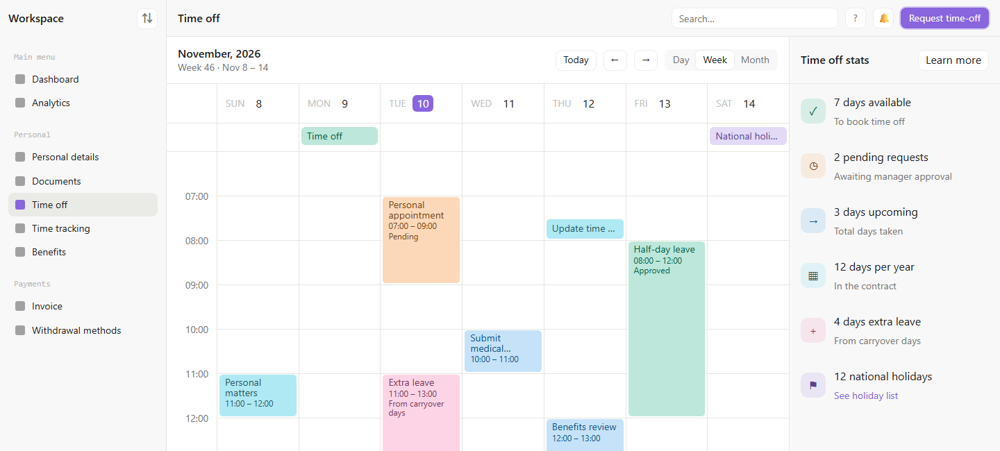
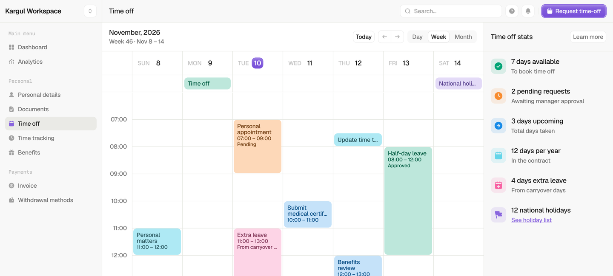
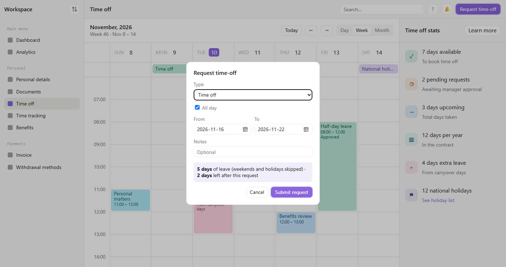
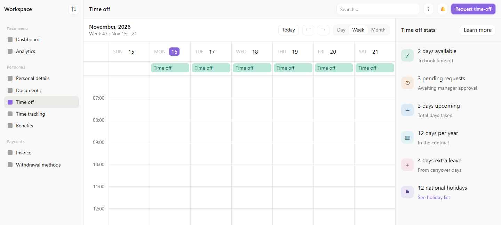
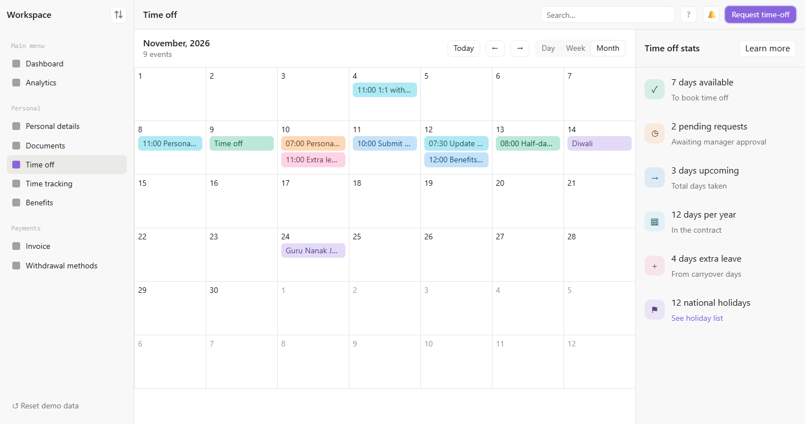
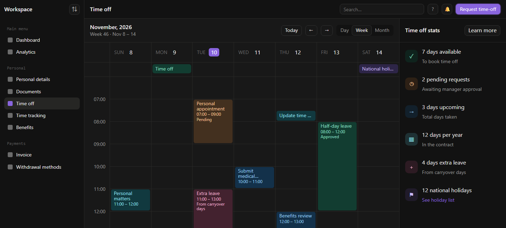

<div align="center">

# timeoff-html

**Open a polished time-off calendar as a file: drag to plan, request leave, watch your balance update.**

The Figma-faithful "Time off" page of [calender-app-design](https://github.com/kargulstudio/calender-app-design) (780+ stars in its first week), without Next.js, React, Tailwind or 795 npm packages. One HTML page and one script.

Works with **Claude Code** and **Codex**.

 



<sub>Screenshot of <code>index.html</code> opened straight from disk in Edge (headless, 1440x650). Nothing is mocked up.</sub>

</div>

## Quick start
```bash
git clone https://github.com/Dodai0419/timeoff-html && cd timeoff-html
start index.html        # macOS: open index.html · Linux: xdg-open index.html
```
No install and no build step. It also works from `file://`, so you can email it or drop it in a shared folder.

The same rules from the terminal:
```bash
node timeoff.js --demo
```
```
November, 2026 · Week 46 · Nov 8 – 14
  SUN 8  11:00-12:00 Personal matters
  MON 9  [Time off]
  TUE 10  07:00-09:00 Personal appointment · 11:00-13:00 Extra leave
  WED 11  10:00-11:00 Submit medical certificate
  THU 12  07:30-08:00 Update time tracking · 12:00-13:00 Benefits review
  FRI 13  08:00-12:00 Half-day leave
  SAT 14  [Diwali]
Time off stats:
  7 days available · 2 pending · 3 days upcoming · 12 days per year · 4 days extra · 12 holidays
Request Nov 16-22 → 5 days (weekend skipped) → 2 days left
```

## Side by side

| Original (Next.js app, from its README) | timeoff-html (opened as a file) |
|---|---|
|  |  |

Same week, same events, same all-day lane, same six stats computed from the same requests. The stat numbers match the original's own test (`leave.test.ts`: 7 available, 2 pending, 3 upcoming, 12 + 4 days, 12 holidays).

## Gallery

**Request time-off.** The dialog counts working days as you type: weekends and national holidays are skipped. It also shows what will be left:



**After submitting.** The calendar jumps to that week and the stats update at once (2 days available, 3 pending):



**Month view**, with holidays in purple:



**Dark mode** follows your system setting:



## What works
- **Week / day / month views**, Today and previous/next navigation, ISO week numbers.
- **Drag on empty space** to create an event, or turn the selection into a leave request. **Drag an event** to move it, also across days. **Drag its bottom edge** to resize it. All of these snap to 15 minutes. Overlapping events sit side by side.
- **Request dialog** for all-day ranges or a few hours. All-day requests count working days. Timed requests count hours of an 8-hour day. The rules are the original's `measureRequest` and `submitRequest`.
- **Live stats panel**: available, pending, upcoming, contract days, carryover, national holidays. Click a stat for the holiday list, the pending requests or the leave policy.
- **Search** filters events by title. Click an event for details, or to delete it along with its request.
- Saved in `localStorage`. **Reset demo data** in the sidebar restores the design state.

## The problem
- A design prototype you want to show someone should not need `npm install`, a dev server and Node 20.
- The original is 14,477 lines across 162 files for a page that is mostly one calendar and one panel.
- Reusing just the calendar means unpicking Next.js routing, Zustand stores and shadcn components.

## The solution
| Idea | Fixes |
|------|-------|
| **One page plus one plain script**, CSS variables copied from the Figma tokens | Opens from disk, no toolchain |
| **Logic in `timeoff.js`** (dates, leave rules, overlap layout), loadable by the browser and by Node | The rules are unit-tested and reusable |
| **Upstream tests ported 1:1** (`dates.test.ts`, `leave.test.ts`, `layout.test.ts`) | Same numbers as the original |

## Use with Claude Code
```bash
/plugin marketplace add Dodai0419/timeoff-html
/plugin install timeoff-html@timeoff-html
```
Then ask: *"Make me a team leave calendar for December with our public holidays."*

## Use with Codex (ChatGPT)
```bash
git clone https://github.com/Dodai0419/timeoff-html && cp -r timeoff-html/skills/* ~/.codex/skills/
```
Or copy `AGENTS.md` into your project root.

## Benchmarks

| | calender-app-design | timeoff-html |
|-|-|-|
| lines of code, whole app (`src/**/*.{ts,tsx,css}`, no tests) | 14,477 | 404 |
| lines for the Time off page and calendar (time-off/, calendar/, dates, leave, request dialog) | 2,492 | 404 |
| files in repo | 162 | 16 |
| npm dependencies (direct / locked) | 14 + 9 dev / 795 | 0 / 0 |
| build step | `npm install` + `next dev` | none (open the file) |
| page weight (HTML + JS, uncompressed) | not measured | 34.9 KB |
| page load to rendered week | not measured (needs npm) | not measured |

Upstream counts are from `git ls-files 'src/*' | grep -E '\.(ts|tsx|css)$' | grep -v test | xargs wc -l` and `package-lock.json` at commit `b4a9e8b`. Windows 11, Node 24.

**Checks:** `node --test` runs 14 tests. 12 are ported from the original's vitest suites (week building, ISO week 46, range labels, month grid, time formats, stats from the seed, working days, durations, overlap layout, 15-minute snap). 2 are new and cover the request flow. A headless Edge run also scripted the UI: request dialog math, stats update, a drag that moves an event, the month view and reset. All 10 checks passed.

## Not included
The original also has dashboard, analytics, documents, invoice, benefits and settings pages, a ⌘K palette, a requests table and a workspace switcher. This repo keeps only the Time off page. The sidebar items for those pages are there for layout but do nothing.

## Inspired by
- [kargulstudio/calender-app-design](https://github.com/kargulstudio/calender-app-design): the design, tokens, demo data and leave rules (MIT)

## Roadmap
- [ ] Requests table with approve/decline
- [ ] Load holidays from an `.ics` URL
- [ ] Shareable team view (one JSON per person)

## License
MIT. Design, tokens, demo data and rules adapted from calender-app-design (see LICENSE).
